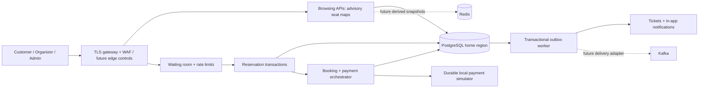
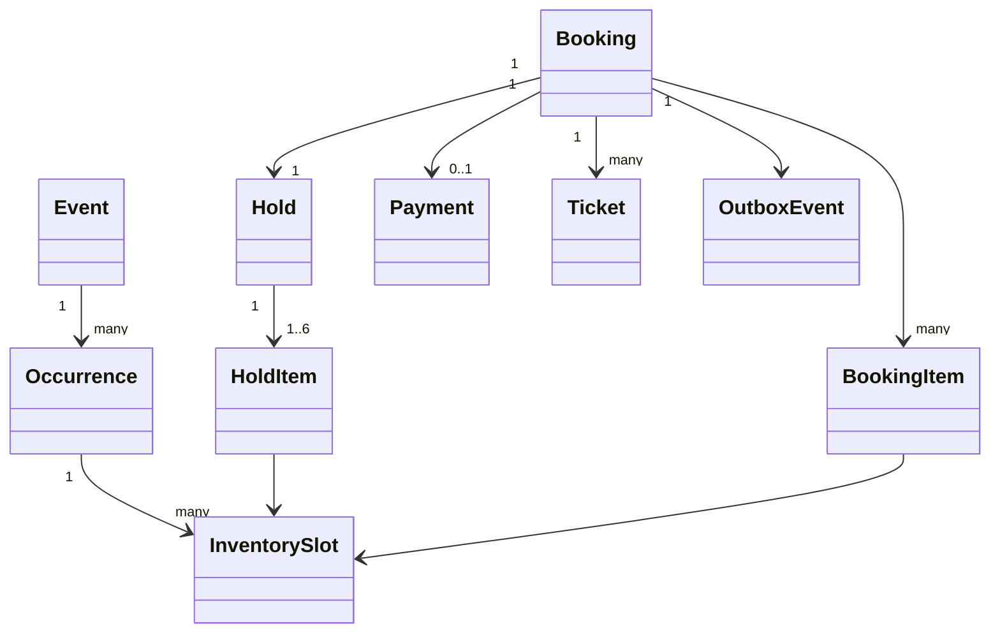

# Architecture and boundaries

Choose a modular monolith: one ACID transaction can commit ownership, booking, payment-simulator state, and an outbox
record. JDBC avoids obscuring lock behavior. PostgreSQL READ COMMITTED plus explicit locks and constraints is the
baseline. Domain services are transaction boundaries, Store is a small SQL adapter, controllers derive identity from
authentication. This is pragmatic layering, not a claim of full domain-framework isolation.



| Deployment               | Correctness / latency                              | Operations / scaling                                                       |
|--------------------------|----------------------------------------------------|----------------------------------------------------------------------------|
| Modular monolith, chosen | Local ACID, one inventory writer                   | Low deployment cost; scale reads/instances together; DB remains bottleneck |
| Domain microservices     | Inventory retains local ACID; cross-service Saga   | Independent scaling/failures; message contracts and reconciliation cost    |
| Global platform          | Home-region inventory coordination; regional reads | Higher resilience/cost; routing, fencing and residency obligations         |

Browse responses can move to CDN/Redis snapshots; inventory mutations must route to the authoritative database. Neither
Redis nor Kafka decides final seat ownership. Do not put a million waiting users into the JDBC connection pool. The
representative DB waiting room is not a million-user edge implementation.



Aggregate boundaries: catalog owns publication, reservation transaction owns hold and inventory changes, checkout owns
booking and payment state, tickets own validation state. Inventory mutation is deliberately a multi-row transactional
component: a one-seat aggregate cannot independently enforce an all-or-nothing six-seat hold.

```mermaid
sequenceDiagram
 Customer->>Catalog: Discover event and advisory seats
 Customer->>Reservations: POST holds + idempotency + admission
 Reservations->>PostgreSQL: Lock event (shared), user quota, sorted inventory
 PostgreSQL-->>Reservations: Current rows; reject entire selection on conflict
 Reservations->>PostgreSQL: Hold + ownership + items + outbox + replay record
 Reservations-->>Customer: Hold ID, total, authoritative expiry
 Customer->>Booking: Create pending booking
 Customer->>Payment: Initiate simulator effect (durable PENDING)
 Payment->>PostgreSQL: Capture or compensate under hold and inventory locks
 PostgreSQL->>Outbox: BookingConfirmed
 Outbox->>Ticket: Idempotent issue + notification
```

Virtual threads are enabled for blocking HTTP/JDBC workloads; a 20-connection pool, 2s acquisition timeout, 5s
statements, 2,000 accepted connections and 100 accept backlog bound parts of the system. This does not bound all ingress
memory: deploy gateway concurrency limits and test overload. HPA replicas multiply DB connections; max six replicas
consumes up to 120 plus operations/migration connections. Reserve database capacity before scaling.

Multi-region: deploy multi-AZ first with synchronous database durability. Active-passive failover requires fencing old
primary, confirming WAL recovery and reconciling payments. Asynchronous replicas can serve stale browsing but cannot
authorize holds. Route each event to a home region; freeze booking during uncertain failover. Fully active-active
ownership requires consensus or serializable global coordination and has a cross-region latency cost. RPO/RTO are
deployment-specific and unverified.
