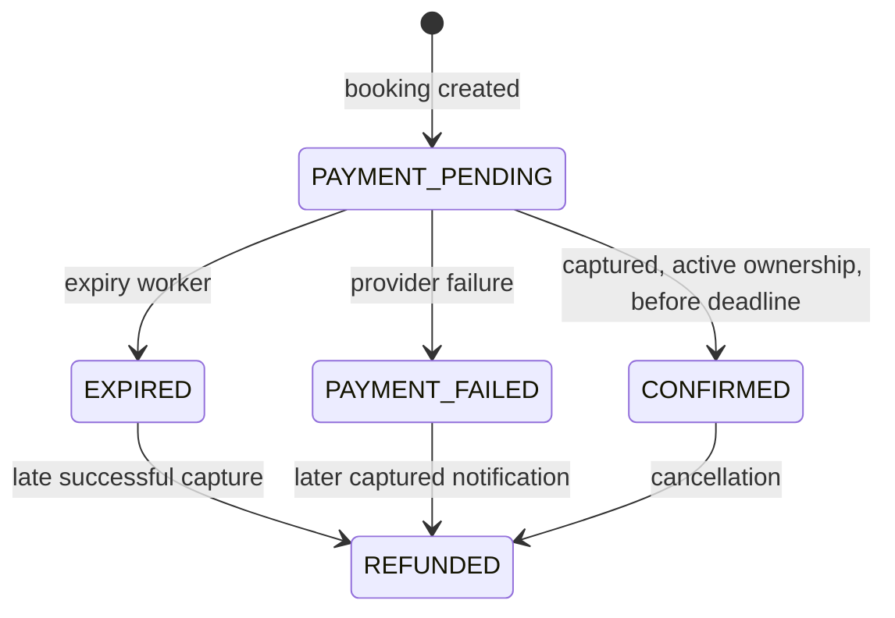

# Payment and recoverable booking workflow

The provider is a local PostgreSQL-backed simulator, not Stripe/Razorpay. Its effect and orchestration are atomic in one
database; this must not be generalized to external payment exactly-once guarantees. One payment per booking, unique
booking hold, and required per-principal idempotency keys prevent duplicate simulator charges. Provider-side idempotency
and external reconciliation are mandatory before replacing this adapter.



Payment states are PENDING, CAPTURED, FAILED, REFUNDED; tickets have VALID, USED, CANCELLED. SUCCESS captures after ~1s,
FAIL fails after ~1s, TIMEOUT remains ambiguous for 30s then reconciliation reports capture. Polling workers query at
most 100 due attempts. Calls and webhooks use the same settlement transaction. Amount comes from the booking's hold
total; external webhook clients cannot submit an amount or customer identity.

```mermaid
sequenceDiagram
 Client->>Saga: Create booking from owned active hold
 Saga->>DB: Persist payment PENDING with stable ID
 Note over Saga,DB: Crash/restart retains pending intent
 Reconciler->>DB: Retrieve due provider outcome
 Reconciler->>Inventory: Shared event lock; hold and inventory locks
 alt Active, still owned, before expiry, event published
 Inventory->>DB: Conditional ACTIVE → CONFIRMED
 Inventory->>DB: Inventory SOLD + booking + payment + outbox
 else Expired / released / reassigned / event cancelled
 Inventory->>DB: REFUNDED payment; never acquire a newer owner's seat
 end
 Outbox->>Tickets: Issue idempotently
 Outbox->>Notifications: Unique event ID in-app delivery
```

The commit point is the conditional hold update after inventory locks using DB wall time. Payment-pending holds receive
no extension. A successful late charge is refunded by the simulator; in an external integration this would instead
create a durable REFUND_PENDING effect, provider-idempotent retry and reconciliation until refund confirmation. Current
full refund completion is deliberately synchronous only because the provider ledger is local.

Webhook authenticity: `X-Timestamp` is Unix seconds, tolerated ±300s; `X-Signature` is base64url-without-padding
HMAC-SHA256 over `<timestamp>.<exact raw JSON body>`, using WEBHOOK_SECRET. Required JSON: `eventId`, `paymentId`,
`state` (CAPTURED or FAILED). Event IDs are durable dedupe keys; altered replay content is rejected. A FAILED after
CAPTURED cannot regress success; CAPTURED after FAILED triggers compensation. REFUNDED is terminal. Provider
amount/currency checks, key rotation, event sequencing and receipt retention must be redesigned for a real provider.

Outbox writes share domain commits. Consumers lock pending events with SKIP LOCKED, issue tickets under booking lock,
insert a unique notification event ID and mark processed in one transaction. Crash rollback means safe retry. This is a
database worker, not implemented Kafka transport. A production broker adapter publishes at least once, commits publish
markers only after ACK, and consumers dedupe event IDs. Unknown schema versions must go to a bounded dead-letter/review
path. Current worker retries failed batches indefinitely without DLQ; one poison event can block a batch, a documented
production gap.
