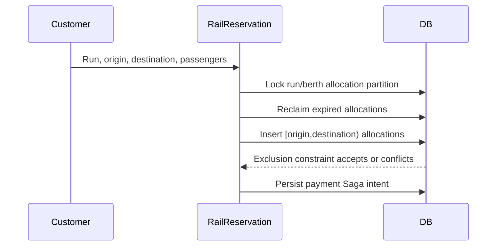
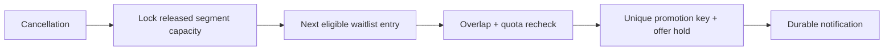

# Railway extension — design only

No rail booking, waitlist or RAC endpoints are implemented. Event seats are not railway berths. Proposed aggregates:
Train, versioned Route with ordered Stations, TrainRun (service date), Coach, Berth, PassengerReference, Allocation,
WaitlistEntry. A berth belongs to a run; journeys use integer half-open station indices `[origin,destination)`.

Executable proposal for an isolated future migration (not installed by event migrations):

```sql
CREATE EXTENSION IF NOT EXISTS btree_gist;
CREATE TABLE berth_allocations (
 id uuid PRIMARY KEY,
 run_id uuid NOT NULL,
 berth_id uuid NOT NULL,
 origin_index int NOT NULL CHECK(origin_index>=0),
 destination_index int NOT NULL,
 state text NOT NULL CHECK(state IN ('HELD','CONFIRMED','RELEASED')),
 CHECK(destination_index>origin_index),
 EXCLUDE USING gist (
   run_id WITH =, berth_id WITH =,
   int4range(origin_index,destination_index,'[)') WITH &&
 ) WHERE (state IN ('HELD','CONFIRMED'))
);
```

A→C = [0,2), C→E = [2,4) coexist; B→D = [1,3) conflicts. Route versions cannot change station ordering for a sold run.
An expired hold must transition out of HELD under locks before replacement: exclusion predicates cannot safely depend on
current time. Expiration and admission must lock the berth/run coordination row and reclaim stale allocations
transactionally.



Waitlist design: durable monotonic sequence per run/class/quota; eligible entries sorted by policy version, priority,
then sequence. Cancellation locks affected capacity and a candidate entry using SKIP LOCKED; a unique promotion/capacity
event key prevents duplicate promotion. Recheck all journey segments before allocation. Expiry of a promoted offer
returns it through the same protocol. RAC requires a separate shared-accommodation capacity model and configurable
rules; do not relax berth exclusion to claim IRCTC equivalence.



Tatkal quotas, passenger eligibility, RAC sharing, promotion order and charting are policy/versioned extensions
requiring official operational verification before implementation. Railway overlap tests are therefore not claimed as
executed.
