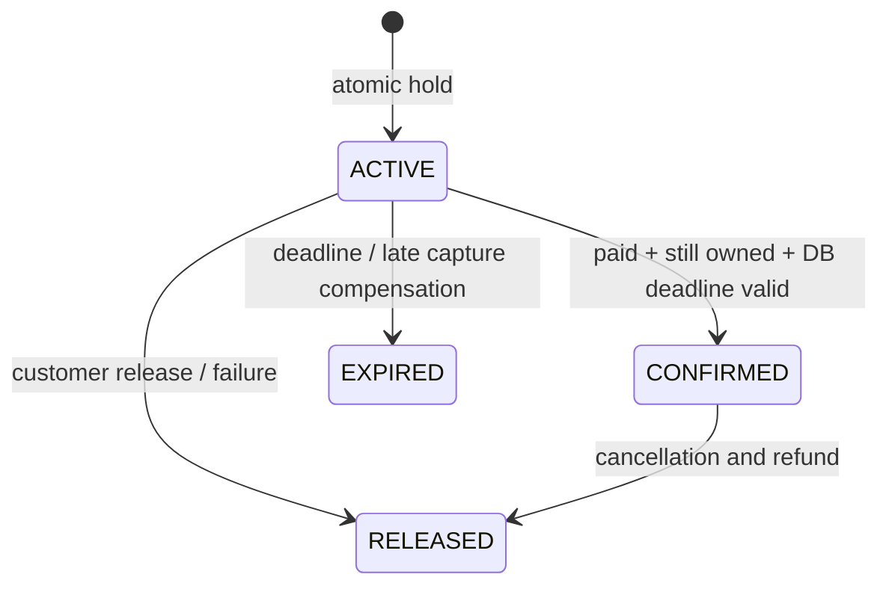

# Reservation lifecycle



No hold extension is offered in the baseline; permitting extensions requires bounded policy, ownership verification and
synchronized inventory expiry updates. No CONFIRMING state is needed because the local confirmation uses one database
transaction. PAYMENT_PENDING is durable on booking/payment separately; it does not extend a hold.

```mermaid
sequenceDiagram
 Worker->>DB: Select 100 expired ACTIVE holds FOR UPDATE SKIP LOCKED
 Worker->>DB: Lock associated inventory in UUID order
 Worker->>DB: Clear only HELD rows still owned by that hold
 Worker->>DB: Mark hold EXPIRED; pending booking EXPIRED; outbox
 Worker->>DB: Commit
```

DB `clock_timestamp()` is used after inventory lock acquisition for the final conditional confirmation. A scan delayed
by a worker crash does not keep seats reserved indefinitely: the next reservation can reclaim expired rows safely.
Repeated cleanup is harmless. A crash before commit rolls back; a crash after commit preserves the expiry outbox event.
Local UI countdown is advisory. DB clock jumps affect deadline policy; use disciplined database time and monitor NTP
rather than assuming perfect clocks.

The indexed scan is bounded to 100 per second per worker invocation; at peak load this must be tuned against measured
lag and DB contention. Current transaction batches can retain multiple hold locks; additional parallel workers need load
testing. Worker exception logs surface failed batches, and the next scheduled run retries durable rows.
