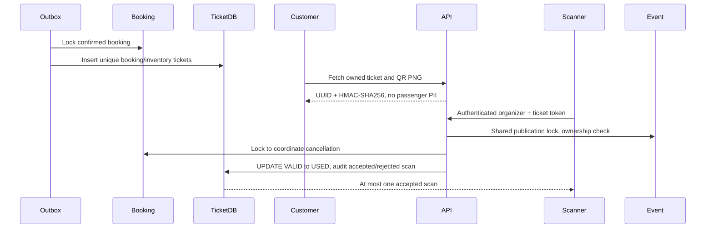

# Ticket issuance and validation

Online validation rejects invalid signatures, other organizers, cancelled events, expired validity (start +24h),
cancelled tickets, and previously used tickets. Ticket issuance is eventually processed through the outbox; a paid
booking can briefly have an empty ticket list. Replaying issuance cannot duplicate the same booking/seat ticket. The QR
renderer is verified by decoding the generated PNG in the integration test. The browser test verifies the PNG is
displayed. Offline readers can verify HMAC only if trusted with the signing key, which is not recommended; asymmetric
signatures and cached revocation with explicit offline duplicate-use risk would be a separate design.
