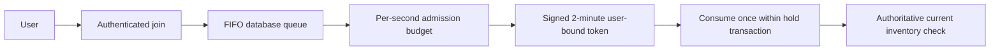

# Admission and traffic protection

The implemented representative waiting room uses PostgreSQL, not Redis. Join creates a per-customer FIFO identity
position. The earliest pending customer can request admission, with a row-locked global per-second budget (default 20).
Admission yields a signed user-bound token for two minutes. A successful hold consumes it transactionally; failed
all-or-nothing attempts roll back consumption. Replays cannot create a second hold; idempotent hold retries return the
existing hold before consumption. Rejoining an expired admission receives a new queue position.

This queue requires head users to poll; it does not promise perfect fairness or support one million polling users.
Abandoned pending positions expire after five minutes. Production should use an edge waiting room with durable
sequence/admission epochs, reconnect identity and signed tokens; edge per-IP/device controls, identity verification and
bot challenges are not implemented. FIFO measures database insertion order, not arrival at a customer's device.
Randomized presale admission needs a committed batch/seed; weighted verified groups need auditable eligibility policies.

Reservation attempts are limited to 30/minute/principal in a durable DB bucket. This and a six-seat user limit are basic
abuse controls, not a complete anti-scalping system. Admin waiting-room settings currently use WAITING_ROOM and
ADMISSION_PER_SECOND environment configuration and rolling restart, not a dynamic UI control.

Redis extension: metadata `catalog:{id}:v{version}` TTL 60s, advisory availability `availability:{occ}:v{version}` TTL
1–3s, cache-fill single flight with jitter, token-bucket counters with bounded memory. Invalidate via outbox, tolerate
stale reads; on Redis outage bypass cache under strict DB read admission or return 503. Never let Redis loss unlock
inventory. The optional compose Redis service is not connected to the application; no Redis integration/outage test is
claimed.
